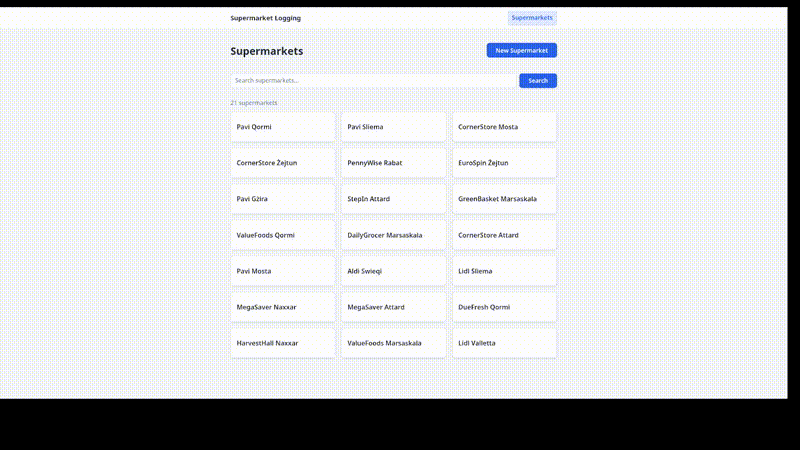
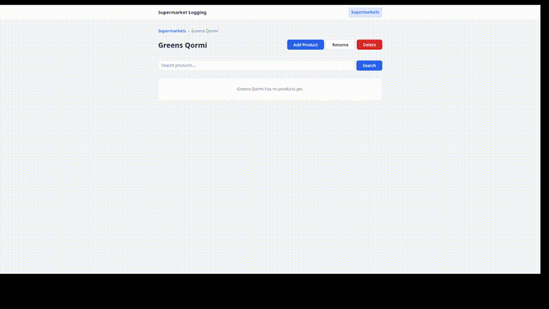
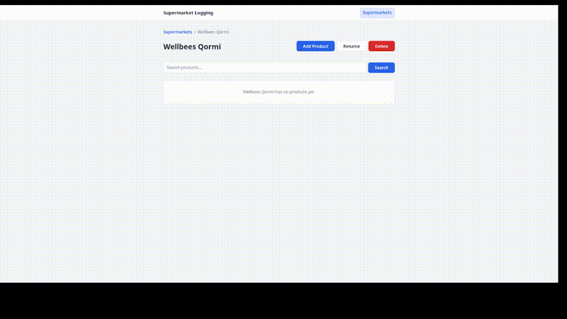
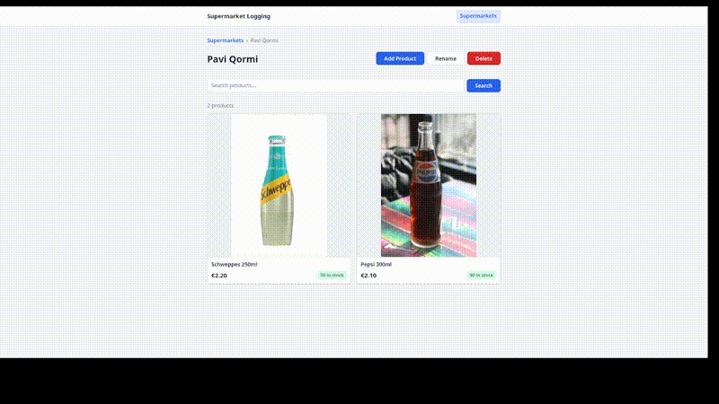
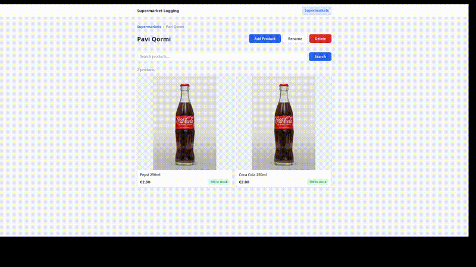
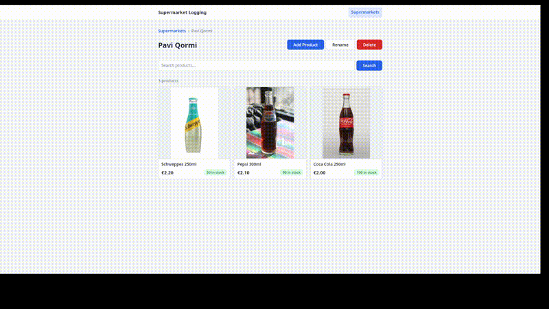
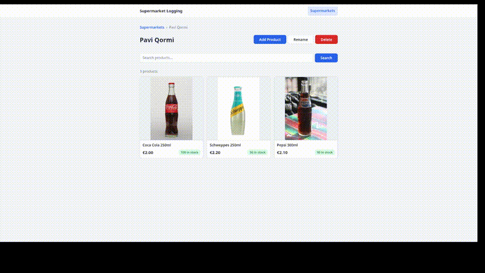
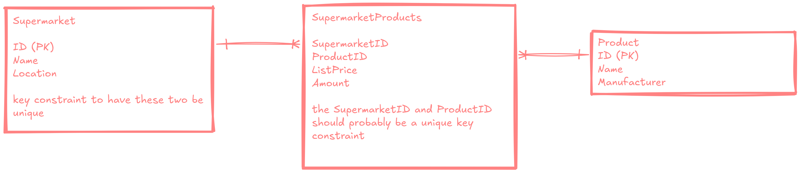
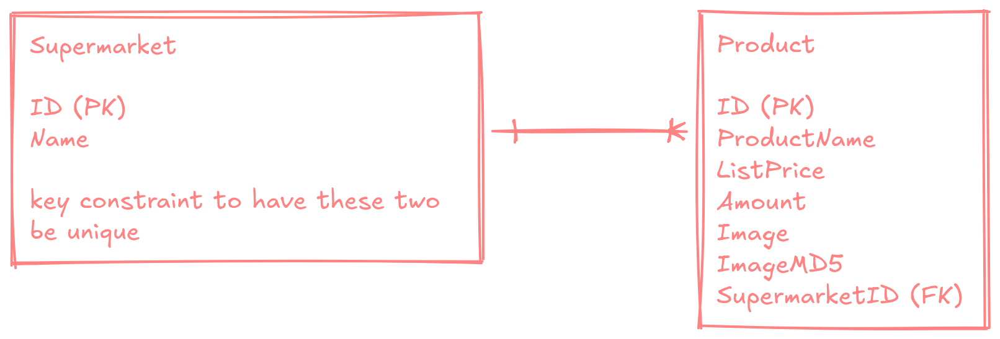

# Supermarket System

A small supermarket stock and price manager written in plain PHP 8.5 and using SQLite,
taking a Server-Side Rendering approach.

This has been an opportunity for me to learn PHP and Server-Side Rendering, and also
how an MVC framework might operate.

## Feature(s)

### Adding a new supermarket



### Renaming a supermarket



### Deleting a supermarket



### Adding a new product



### Editing a product



### Deleting a product



### Capturing with a camera



## Building/Running

requirements: [Docker](https://docs.docker.com/get-docker/) with Docker Compose.

```sh
git clone <repo-url> supermarket-system
cd supermarket-system
docker compose up --build
```

open <http://localhost:5173>.

NOTE: the database will already be seeded with example shops and products using the script in `/bin`

to stop the container run in the directory of project the blow command (-v ensures the volume is also deleted):

```shell
docker compose down -v
```

## Project Structure

```
bin/db             database CLI for creating the app.sqlite DB without needing to run the app
bin/generate-seed  fake data generator
database/          contains app.sqlite (created on first run, not committed)
docker/            entrypoint in docker which is the start of turning on the container; refer to https://docs.docker.com/reference/dockerfile/#understand-how-cmd-and-entrypoint-interact
images/            images used just for this README.md
public/            web root (index.php front controller, css, js, assets)
schema/            create_db.sql, seed.sql and seed images
src/               Router, Database, Controllers, Models, Views & helpers php files
config.php         paths to the database and schema
```

## Design, Research and Observations

1. **Server-side rendering vs. client-side updates.** With PHP rendering the HTML on the
   server, updating the page with `fetch` or XHR adds complexity, because the same markup
   then has to be built and maintained in client-side JavaScript too. To avoid this, the
   app uses plain HTML forms wherever possible.
2. **Security.** All database queries use PDO prepared statements, which prevents SQL
   injection. All output is escaped with `htmlspecialchars`, which prevents cross-site
   scripting (XSS). A helper also escapes the `LIKE` wildcards (`%` and `_`) in search
   terms, so they are matched as literal characters.
3. **Storing images as BLOBs.** Storing images in the database is unusual. It does,
   however, require checking every upload's file type and size, so the file is valid and
   small enough to stay within PHP's upload limits.
4. **Testing.** I used Claude Code to probe for issues like these. Ideally, this would be
   replaced by a proper automated test suite.
5. **Documentation.** I used Claude Code to generate PHPDoc comments in some places, which
   improves editor autocompletion.
6. **CSS.** Claude Code produced an initial CSS template, which I then reviewed and
   adjusted for responsiveness. The MDN Web Docs were the most useful resource for
   understanding CSS behaviour.
7. **No CSS framework.** I normally use Tailwind, but it needs a build step, which would
   have made the project significantly more complex. Loading Bootstrap from a CDN was
   also ruled out, because it makes the app depend on infrastructure outside its own
   server.
8. **Implicit variables in views.** One annoyance with PHP is that an included view file
   can read any variable from the scope that includes it, without that variable being
   passed in explicitly. This makes views harder to maintain, and it is quite different
   from frameworks like React, where a component only receives the props it is given.

## ERD

### Initial ERD



The above ERD was my initial suggestion for an ERD, because it allows for the same product to be listed
across many different supermarkets. A **benefit** of this way of structuring the data is that we can
find discrepancies between different stores selling the same product at different prices. However,
a **disadvantage** is a complicated user workflow.

### Final ERD



Above ERD, solves the issue with the user journey and also reduces overall
program complexity but trades of queryability and also sacrifices more disk space.
An alternative would be expecting a SKU number which can help identify and merge
two products, nevertheless the images need to retained for every submission.
